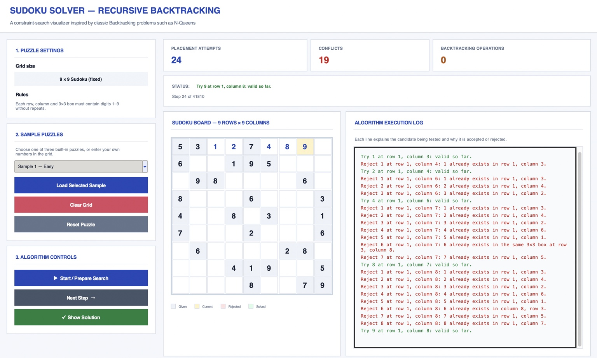

# DAA Sudoku — Recursive Backtracking Visualizer

A desktop Sudoku solver built with Python and Tkinter to demonstrate the **recursive Backtracking algorithm** for a Design and Analysis of Algorithms assignment.

## Application Screenshot

The screenshot below shows the GUI with the sample Sudoku puzzle, placement/conflict/backtracking counters, coloured controls, and the algorithm execution log.



## Features

- Interactive 9×9 Sudoku grid
- Built-in sample puzzles
- Load Sample, Clear Grid, and Reset Puzzle controls
- Start / Prepare Search, Next Step, and Show Solution controls
- Live counters for placement attempts, conflicts, and backtracking operations
- Colour-coded given, current, rejected, and solved cells
- Algorithm execution log with explanations for accepted and rejected candidates

## Run the application

Requires Python 3 with Tkinter.

```bash
python3 main.py
```

No third-party Python packages are required.

## How the algorithm works

1. Find an empty cell.
2. Try digits from 1 to 9.
3. Check whether the digit already appears in the same row, column, or 3×3 box.
4. If valid, place the digit and recursively solve the remaining puzzle.
5. If the choice leads to a dead end, remove it and try another digit.
6. If no empty cells remain, the puzzle is solved.

Sudoku uses the general recursive Backtracking technique. N-Queens is another classic problem that can be solved using backtracking; this application specifically solves Sudoku.

## Complexity analysis

Let `m` be the number of initially empty cells.

- **Time complexity:** A loose worst-case bound is `O(9^m)`. Constraint checks prune many candidate choices, so actual work depends on the puzzle.
- **Auxiliary space complexity:** `O(m)` for the recursion stack, up to 81 cells for a 9×9 grid.
- **Board storage:** `O(81)` for the fixed 9×9 board.

## Suggested demonstration

1. Run the application.
2. Load a sample puzzle.
3. Click **Start / Prepare Search**.
4. Click **Next Step** to view candidate checks and conflicts in the execution log.
5. Click **Show Solution** to display the completed puzzle.
